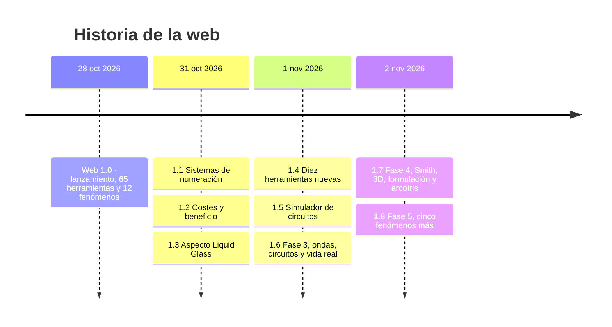

# Ciencify

**Simuladores y calculadoras de ciencias para la carrera, en español, gratis y sin registro.** Resuelven los problemas paso a paso y con la misma notación que en clase.

🌐 **Web:** <https://simulaciencia.vercel.app/> · también en <https://electromagnetismo.aceropuro30.workers.dev>

<!-- cifras:inicio (lo escribe fuente/portal.js desde el catálogo; no editar a mano) -->
| | |
| --- | --- |
| **105** herramientas | repartidas en 7 asignaturas |
| **22** fenómenos de «Física en la vida real» | animaciones que explican cosas cotidianas |
| **Web 1.11** | última versión (2 nov 2026) |
<!-- cifras:fin -->

JS puro, sin framework ni dependencias: una web estática que se genera con `sh fuente/build.sh` y se publica desde `publico/`.

## Asignaturas

<!-- asignaturas:inicio (generado) -->
| Asignatura | Herramientas | Próximamente |
| --- | :-: | :-: |
| Electromagnetismo | 14 | 0 |
| Física general | 19 | 0 |
| Química | 14 | 0 |
| Matemáticas | 15 | 0 |
| Estadística | 11 | 0 |
| Circuitos | 6 | 0 |
| Economía | 26 | 0 |
<!-- asignaturas:fin -->

## Hoja de ruta

La web sale en versiones. Las fases ordenan lo que falta solo por dificultad de construcción.

| Fase | Estado | Contenido |
| --- | --- | --- |
| 1 y 2 | ✅ Hecha | Herramientas fáciles y medias de todas las asignaturas |
| 3 | ✅ Hecha (Web 1.6) | Maxwell, Fresnel, gravitación, óptica, Bode, convolución, Laplace numérica, imágenes, guías de onda, antena y 4 fenómenos |
| 4 | ✅ Hecha (Web 1.7) | Líneas de transmisión y carta de Smith, superficies 3D, balance y cuenta de resultados, integrales múltiples, redox, VSEPR 3D y formulación inorgánica y el arcoíris |
| 5 | ✅ Hecha (Web 1.8) | Los fenómenos del rayo, las auroras, el altavoz y el motor, la cocina de inducción y el cargador inalámbrico |
| Más adelante | 💭 Sin fecha | Foro propio, dominio propio |

El detalle de cada versión está en [Novedades](https://simulaciencia.vercel.app/novedades/). La línea del tiempo interna se genera con `node interno/linea-tiempo/generar.js`.

## Desarrollo

Las normas del proyecto están en [CLAUDE.md](CLAUDE.md) y la guía de diseño en [DISENO.md](DISENO.md). Antes de fusionar: `node pruebas/comprobar.js`.

---

## Detalles técnicos

Simuladores y calculadoras por asignatura. Es una web estática en `publico/`:

- `publico/index.html`: la portada, donde se elige asignatura y herramienta.
- `publico/<asignatura>/index.html`: una página por asignatura (electromagnetismo, fisica, quimica, matematicas, laboratorio).
- `publico/<asignatura>/<herramienta>/index.html`: cada herramienta. El simulador de electrostática (`electromagnetismo/electrostatica/`) sale de `fuente/*.js`; las herramientas nuevas tienen su carpeta en `fuente/` (por ejemplo `fuente/magnetostatica/`: `fisica.js`, `ejemplos.js`, `app.js` y `pagina.html`) y `build.sh` las junta con la función `herramienta`. Sus ejemplos se comprueban contra `pruebas/esperados-<herramienta>.json`.

La portada y las páginas de asignatura las genera `fuente/portal.js` a partir de `fuente/catalogo.js`. Para añadir una herramienta, ponla en el catálogo con `disponible: true`, genera su página en `publico/<asignatura>/<herramienta>/index.html` y añade sus pruebas a `pruebas/comprobar.js`.

**Diseño:** toda herramienta nueva sigue [DISENO.md](DISENO.md). Se empieza copiando `fuente/plantilla/pagina.html`; la hoja común `fuente/estilos.css`, el color de la asignatura y la cabecera los pone `fuente/diseno.js` al publicar, y la comprobación falla si una página vuelve a definir un estilo común o pone colores fijos.

- Código fuente: `fuente/` (engine, fmt, physics, presets, canvas, app y shell.html). Las capturas de la guía de uso están en `fuente/guia/` y `build.sh` las incrusta en la página.
- Para regenerar la web pública tras cambiar las fuentes: `sh fuente/build.sh` (simulador, portada y asignaturas).
- **Solo se publica la carpeta `publico/`** (página, iconos y lo que se añada para la web). Vercel la sirve tal cual por `vercel.json`; en Cloudflare Pages el proyecto se configura con *Framework: None*, sin comando de compilación y *Output directory* `publico`. No pongas ahí nada más: la comprobación falla si aparece otro archivo.
- Icono: `fuente/icono.svg` (se incrusta en la pestaña). `publico/apple-touch-icon.png` (180×180) y `publico/og.png` (1200×630, vista previa al compartir); si cambias el icono, vuelve a generarlas a partir del SVG.

## Ejercicios: web pública y versión privada

- `fuente/presets.js`: los 12 ejercicios de ejemplo de la web pública, con enunciados propios.
- `privado/tema3-pdf.js`: los 12 ejercicios del Tema 3 del PDF de la asignatura. **No se publican**: solo entran en la versión privada del artifact de claude.ai, que se genera con `sh fuente/build.sh privado SALIDA.html` (sin `<!doctype>`, el artifact añade el esqueleto).
- Capturas de la guía: `node pruebas/capturas.js` las rehace a partir de la web pública (todas menos `editar.webp`).

Los problemas guardados viven en el almacenamiento local de cada navegador. Para pasarlos de un dispositivo a otro, expórtalos como `.emsim.json` e impórtalos en el otro.

## Versión

El número de versión y las novedades están en `fuente/version.js`; la página los muestra en la barra lateral y en la guía. Hasta el lanzamiento se numera 0.x (beta) y la 1.0 será el lanzamiento: sube el segundo número si hay algo nuevo (0.6) y añade un tercero si es solo un arreglo (0.5.1). Las novedades son solo para usuarios; el historial completo está en Notion.

## Comprobación antes de fusionar

`node pruebas/comprobar.js` regenera la web pública y la privada, y resuelve los dos juegos de ejercicios: los del Tema 3 contra `pruebas/esperados.json` (la forma del solucionario, no solo el valor) y los de ejemplo contra `pruebas/esperados-ejemplos.json`. También comprueba que `publico/` no contiene nada del PDF. Después abre las dos páginas en Chromium, abre cada ejercicio y la guía, y falla si hay errores en la consola. Necesita `playwright` (`npm install --no-save playwright`). La misma comprobación corre en GitHub Actions en cada pull request.

La comprobación de cada herramienta está en `pruebas/herramientas/<carpeta>.js` y `pruebas/humo.js` hace la prueba de humo común (cambiar un dato, guardarlo en Mis ejercicios, recargar y verlo de vuelta). Mientras trabajas en una herramienta, `node pruebas/comprobar.js --solo <carpeta>` comprueba solo esa en unos segundos.

Si un cambio de forma es intencionado, ejecuta `node pruebas/comprobar.js --actualizar` y revisa el diff de los esperados.
