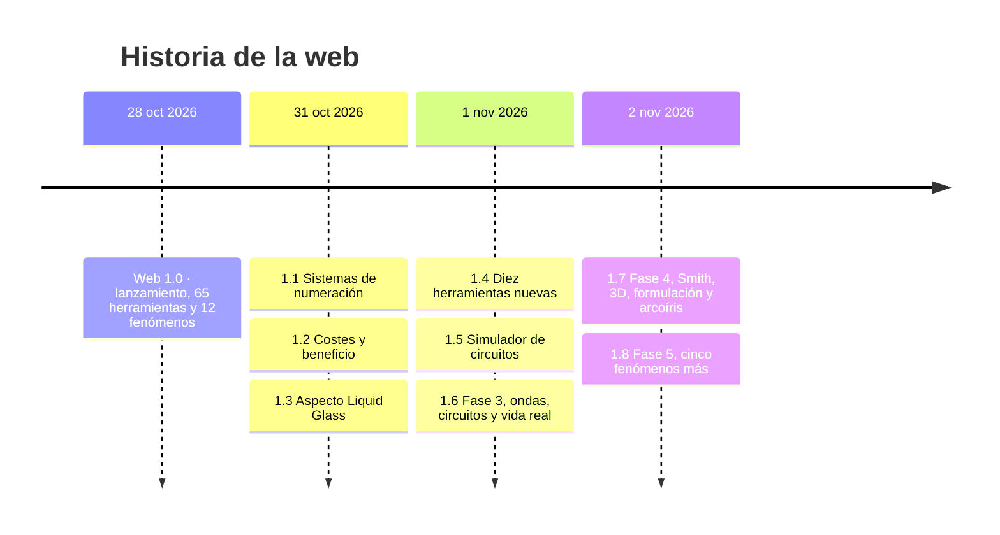

<div align="center">

# 🔬 Ciencify

**Simuladores y calculadoras de ciencias para la carrera.**<br>
Gratis · sin registro · resuelven paso a paso y con la notación de clase.

[**🌐 Abrir la web**](https://simulaciencia.vercel.app/) · [Réplica en Cloudflare](https://electromagnetismo.aceropuro30.workers.dev) · [Novedades](https://simulaciencia.vercel.app/novedades/)

🇪🇸 Español · 🇬🇧 English · 🇫🇷 Français · 🇩🇪 Deutsch

</div>

---

## ✨ Qué es

Ciencify es una colección de herramientas interactivas para estudiar ciencias: dibujas el problema, cambias los datos y ves el resultado, la gráfica y el desarrollo completo. Está pensada para quien cursa Electromagnetismo, Física, Química, Matemáticas, Estadística, Circuitos o Economía.

- 🧮 **Calculadoras y simuladores** que enseñan el procedimiento, no solo el número.
- 🎲 **Ejercicios inventados** con nivel y código para repetirlos, que se corrigen solos.
- 💾 **Mis ejercicios:** guarda, ordena en carpetas, exporta e importa tu trabajo (todo queda en tu navegador).
- 🖨️ **Enunciado, copiar como texto o LaTeX e imprimir** la solución.
- 🌗 Modo claro y oscuro, buscador global (`/` o `Ctrl+K`) y **funciona sin conexión** como web instalable.
- 🌍 **Cuatro idiomas** con sus propias páginas, hreflang y sitemap.

## 📊 En cifras

<!-- cifras:inicio (lo escribe fuente/portal.js desde el catálogo; no editar a mano) -->
| | |
| --- | --- |
| **111** herramientas | repartidas en 7 asignaturas |
| **29** fenómenos de «Física en la vida real» | animaciones que explican cosas cotidianas |
| **Web 1.22** | última versión (18 nov 2026) |
<!-- cifras:fin -->

## 🗂️ Asignaturas

<!-- asignaturas:inicio (generado) -->
| Asignatura | Herramientas | Próximamente |
| --- | :-: | :-: |
| Electromagnetismo | 15 | 0 |
| Física general | 20 | 0 |
| Química | 14 | 0 |
| Matemáticas | 15 | 0 |
| Estadística | 11 | 0 |
| Circuitos | 9 | 0 |
| Economía | 27 | 0 |
<!-- asignaturas:fin -->

## 🌍 Idiomas

| Idioma | Dirección |
| --- | --- |
| 🇪🇸 Español (original) | `/` |
| 🇬🇧 English | `/en/` |
| 🇫🇷 Français | `/fr/` |
| 🇩🇪 Deutsch | `/de/` |

El español es la fuente. Las demás versiones se generan en la compilación sustituyendo textos con diccionarios (`fuente/i18n/<idioma>/`). Cada página enlaza con sus versiones y el navegador solo propone cambiar de idioma, nunca redirige.

## 🚀 Ejecutar en local

```sh
sh fuente/build.sh                     # genera publico/ (la web entera)
node pruebas/comprobar.js              # todas las pruebas (varios minutos)
node pruebas/comprobar.js --solo choques   # solo una herramienta
```

No hay framework ni dependencias: JavaScript puro concatenado por `fuente/build.sh`. Para las pruebas en navegador hace falta Playwright.

## 🗺️ Estructura

| Ruta | Qué contiene |
| --- | --- |
| `fuente/` | Código: catálogo, páginas, utilidades comunes y una carpeta por herramienta |
| `fuente/i18n/` | Diccionarios de traducción por idioma |
| `publico/` | Lo único que se publica (generado, no se edita a mano) |
| `pruebas/` | Pruebas de cálculo, navegador, accesibilidad, rendimiento e idiomas |
| `worker/` | Contador de visitas (Cloudflare Worker, sin cookies ni IP) |

## 🤝 Contribuir

1. Lee [CLAUDE.md](CLAUDE.md) (mapa y normas) y [DISENO.md](DISENO.md) (guía de diseño).
2. Crea una herramienta con `node fuente/nueva.js <asignatura> <clave> "<Nombre>"`; se da de alta sola en el catálogo.
3. Ejecuta `node pruebas/comprobar.js` antes de proponer cambios.
4. Se publica al fusionar en `main` (Vercel y Cloudflare despliegan solos).

Una traducción nueva o corregida se aporta editando el diccionario de su idioma en `fuente/i18n/`.

## Hoja de ruta

La web sale en versiones. Las fases ordenan lo que falta solo por dificultad de construcción.



| Fase | Estado | Contenido |
| --- | --- | --- |
| 1 y 2 | ✅ Hecha | Herramientas fáciles y medias de todas las asignaturas |
| 3 | ✅ Hecha (Web 1.6) | Maxwell, Fresnel, gravitación, óptica, Bode, convolución, Laplace numérica, imágenes, guías de onda, antena y 4 fenómenos |
| 4 | ✅ Hecha (Web 1.7) | Líneas de transmisión y carta de Smith, superficies 3D, balance y cuenta de resultados, integrales múltiples, redox, VSEPR 3D y formulación inorgánica y el arcoíris |
| 5 | ✅ Hecha (Web 1.8) | Los fenómenos del rayo, las auroras, el altavoz y el motor, la cocina de inducción y el cargador inalámbrico |
| Más adelante | 💭 Sin fecha | Foro propio, dominio propio |

El detalle de cada versión está en [Novedades](https://simulaciencia.vercel.app/novedades/). La línea del tiempo interna se genera con `node interno/linea-tiempo/generar.js`.

---

## 🛠️ Detalles técnicos

Es una web estática: portada y asignaturas las genera `fuente/portal.js` desde `fuente/catalogo.js`, y cada herramienta tiene su carpeta en `fuente/<clave>/` (`calculo.js`, `app.js`, `pagina.html`). Toda herramienta nueva sigue [DISENO.md](DISENO.md) y su prueba vive en `pruebas/herramientas/<clave>.js`.

- Vercel sirve `publico/` tal cual (`vercel.json`); en Cloudflare, *Framework: None* y *Output directory* `publico`.
- El icono sale de `fuente/icono.svg`; `publico/apple-touch-icon.png` y `publico/og.png` se rehacen a partir de él.
- Los ejercicios del PDF de la asignatura (`privado/`) **nunca se publican**.
